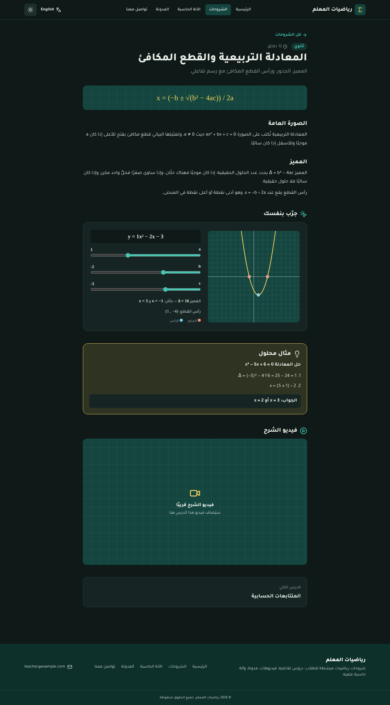

<div dir="rtl">

# رياضيات المعلم

**العربية** · [English](README.en.md)

موقع شروحات رياضيات للطلاب: دروس مع رسومات تفاعلية، فيديوهات، مدونة، آلة حاسبة علمية ونموذج تواصل. يعمل بالعربية والإنجليزية وبالوضعين الفاتح والداكن.


## المحتويات

- [فكرة المشروع](#فكرة-المشروع)
- [الحل](#الحل)
- [المزايا](#المزايا)
- [التقنيات](#التقنيات)
- [الأوامر المستخدمة في بناء المشروع](#الأوامر-المستخدمة-في-بناء-المشروع)
- [التشغيل](#التشغيل)
- [بنية المشروع](#بنية-المشروع)
- [تنظيم الكود](#تنظيم-الكود)
- [تعديل المحتوى](#تعديل-المحتوى)
- [نموذج التواصل](#نموذج-التواصل)
- [النشر على Apache](#النشر-على-apache)
- [الرفع على GitHub](#الرفع-على-github)
- [حدود معروفة](#حدود-معروفة)

## فكرة المشروع

معلم رياضيات يريد مكانًا واحدًا على الإنترنت يرجع إليه طلابه خارج الحصة: يجدون فيه شرح الدرس، ومثالًا محلولًا، وفيديو، وأداة يجرّبون بها الفكرة بأيديهم.

**المشكلة**

- الشرح في الحصة يمر مرة واحدة، ومن فاته جزء لا يجد مرجعًا مرتبًا يعود إليه.
- مواد المعلم موزعة بين مجموعات المحادثة وروابط الفيديو والأوراق.
- كثير من مفاهيم الرياضيات (الميل، المميز، مقارنة الكسور) تُفهم بالتجربة أسرع من القراءة، والكتاب لا يتحرك.
- الطالب يحتاج آلة حاسبة علمية ووسيلة يسأل بها المعلم دون تطبيقات إضافية.

## الحل

موقع ثابت سريع يجمع ذلك كله:

| الحاجة | ما يقدمه الموقع |
|---|---|
| مرجع مرتب للدروس | صفحة شروحات مقسمة حسب المرحلة (ابتدائي، متوسط، ثانوي)، وكل درس فيه شرح مختصر وقانون ومثال محلول |
| الفهم بالتجربة | رسومات تفاعلية يحركها الطالب: مقارنة الكسور، نظرية فيثاغورس، المستقيم، القطع المكافئ |
| الفيديو | مكان لفيديو يوتيوب في كل درس، يُحمَّل المشغّل عند الضغط فقط |
| آلة حاسبة | آلة حاسبة علمية داخل الموقع تعمل بلوحة المفاتيح أيضًا |
| التواصل مع المعلم | نموذج تواصل يوصل الرسالة إلى بريد المعلم |
| محتوى إضافي | مدونة للنصائح والمقالات |
| جمهور أوسع وراحة القراءة | واجهتان عربية وإنجليزية، ووضع فاتح وداكن |

اختير أن يكون الموقع **ثابتًا (Static)** لأنه يعمل على أي استضافة Apache بلا خادم Node، وسريع، وتكلفة تشغيله شبه معدومة.

## المزايا

- **6 دروس** بنصين عربي وإنجليزي، أربعة منها برسم تفاعلي.
- **آلة حاسبة علمية**: دوال مثلثية (درجات/راديان)، جذور، لوغاريتمات، أسس، مضروب، سجل لآخر العمليات. التعابير تُحلَّل بمحلل خاص بلا `eval`.
- **مدونة** بثلاث مقالات.
- **لغتان**: `/ar/` و `/en/`، مع تبديل للصفحة نفسها وقلب الاتجاه (RTL/LTR) تلقائيًا.
- **وضع داكن/فاتح** يتبع إعداد الجهاز في أول زيارة ثم يحفظ اختيار الزائر.
- **SEO**: وسوم Open Graph، `hreflang`، `sitemap.xml`، `robots.txt`.
- **الأداء**: Priority Hints (صورة الواجهة بأولوية عالية، مصغّرات الفيديو بأولوية منخفضة)، خط مستضاف محليًا، تخزين مؤقت وضغط من Apache.



## التقنيات

| التقنية | الإصدار | الدور |
|---|---|---|
| [Next.js](https://nextjs.org) (App Router) | 16.4 | إطار العمل وتوليد الموقع الثابت (SSG عبر `output: "export"`) |
| [React](https://react.dev) | 19 | بناء الواجهة والمكونات التفاعلية |
| [TypeScript](https://www.typescriptlang.org) | 5 | الأنواع |
| [Tailwind CSS](https://tailwindcss.com) | 4 | التنسيق، وألوان الوضعين عبر متغيرات CSS |
| [Turbopack](https://nextjs.org/docs/app/api-reference/turbopack) | مع Next.js | التطوير والبناء |
| [Lucide](https://lucide.dev) | `lucide-react` | الأيقونات |
| [Tajawal](https://fontsource.org/fonts/tajawal) | `@fontsource/tajawal` | الخط العربي واللاتيني، مستضاف محليًا |
| ESLint + Prettier | 9 / 3 | فحص الكود وتنسيق موحّد |
| Node.js test runner | مدمج | اختبارات الوحدات بلا حزم إضافية |
| Apache HTTP Server | 2.4 | الاستضافة، مع HTTP/2 والضغط والتخزين المؤقت |
| Priority Hints | `fetchPriority` | ترتيب أولوية تحميل الصور |
| Open Graph | Metadata API | بطاقات المشاركة في وسائل التواصل |
| [Web3Forms](https://web3forms.com) أو PHP | اختياري | إرسال نموذج التواصل |

## الأوامر المستخدمة في بناء المشروع

<div dir="ltr">

```bash
# 1) إنشاء المشروع: TypeScript + Tailwind + App Router + Turbopack
npx create-next-app@latest riyadiyat-almoallem \
  --ts --tailwind --app --turbopack \
  --no-eslint --no-src-dir --import-alias "@/*" --use-npm

cd riyadiyat-almoallem

# 2) الأيقونات والخط
npm install lucide-react @fontsource/tajawal

# 3) أدوات جودة الكود
npm install -D prettier eslint eslint-config-next

# 4) التطوير
npm run dev

# 5) الفحص ثم البناء (ينتج مجلد out/ الثابت)
npm run check
npm run build
```

</div>

بعد الإنشاء عُدّل `next.config.ts` ليكون البناء تصديرًا ثابتًا:

<div dir="ltr">

```ts
const nextConfig: NextConfig = {
  output: "export",       // موقع ثابت في out/
  trailingSlash: true,    // كل صفحة = مجلد/index.html ليخدمها Apache مباشرة
  images: { unoptimized: true },
  experimental: { globalNotFound: true }, // صفحة 404 موحدة
};
```

</div>

## التشغيل

المتطلبات: Node.js 20 أو أحدث (`npm test` يحتاج 22.6 أو أحدث).

<div dir="ltr">

```bash
npm install
cp .env.example .env.local   # ثم عدّل القيم
npm run dev                  # http://localhost:3000
```

</div>

| الأمر | الوظيفة |
|---|---|
| `npm run dev` | خادم التطوير |
| `npm run build` | بناء الموقع الثابت في `out/` |
| `npm run check` | فحص الأنواع + ESLint + الاختبارات دفعة واحدة |
| `npm run typecheck` | فحص TypeScript |
| `npm run lint` | ESLint |
| `npm test` | اختبارات منطق الآلة الحاسبة والرياضيات |
| `npm run format` | تنسيق الكود بـ Prettier |

متغيرات البيئة (`.env.local`):

| المتغير | الوظيفة |
|---|---|
| `NEXT_PUBLIC_SITE_URL` | رابط الموقع النهائي، يُستخدم في Open Graph و sitemap |
| `NEXT_PUBLIC_WEB3FORMS_KEY` | مفتاح Web3Forms لنموذج التواصل (اختياري) |

## بنية المشروع

<div dir="ltr">

```
app/
  [lang]/                   صفحات الموقع لكل لغة
    layout.tsx              القالب الجذري: lang, dir, سكربت السمة
    page.tsx                الرئيسية
    lessons/                قائمة الشروحات + صفحة الدرس [slug]
    blog/                   قائمة المقالات + صفحة المقال [slug]
    calculator/  contact/
  global-not-found.tsx      صفحة 404
  globals.css               ألوان الوضعين والخط
  sitemap.ts, robots.ts
components/                 الواجهة فقط، مقسّمة حسب الميزة
  layout/                   Header, NavLinks, LanguageSwitch, ThemeToggle, useTheme, Footer, PageHeader
  ui/                       Card, Slider, MathText, BackLink, SectionHeader, DirectionalArrow
  home/                     Hero, Features
  lessons/                  LessonCard, StageBadge, Duration, VideoEmbed, LessonWidget
    widgets/                FunctionGrapher, CoordinatePlane, PythagorasExplorer,
                            FractionVisualizer, FractionPie, WidgetLayout
  calculator/               Calculator, Display, Keypad, AngleModeToggle, History,
                            useCalculator, useCalculatorKeyboard
  blog/                     PostCard, PostMeta
  contact/                  ContactForm
lib/                        المنطق والبيانات، بلا واجهة
  i18n/                     config.ts (اللغات)، ar.ts و en.ts (نصوص الواجهة)
  calculator/               evaluate.ts (محلل التعابير)، keys.ts، واختباراته
  math/                     quadratic.ts، fractions.ts، format.ts، واختباراتها
  lessons.ts, posts.ts      المحتوى (عربي + إنجليزي)
  localize.ts               يدمج الحقول المشتركة مع نص اللغة المطلوبة
  routes.ts                 كل روابط الموقع ومعاملات الصفحات
  meta.ts                   canonical + hreflang + Open Graph
  theme.ts, storage.ts      منطق الوضع الداكن، وتخزين آمن
  contact.ts                إرسال نموذج التواصل (Web3Forms أو PHP)
  site.ts, classNames.ts
public/
  .htaccess                 إعدادات Apache
  api/contact.php           معالج نموذج التواصل (بديل PHP)
  index.html                تحويل / إلى اللغة المحفوظة
  hero.svg, og.png, og-en.png, icon.svg
deploy/apache-vhost.conf    مثال VirtualHost مع HTTP/2
```

</div>

## تنظيم الكود

الكود يتبع قواعد بسيطة:

- **المنطق مفصول عن الواجهة.** كل ما في `lib/` هو TypeScript خالص بلا React، فيمكن اختباره وحده. المكونات تعرض وتربط الأحداث فقط.
- **وظيفة واحدة لكل ملف.** الآلة الحاسبة مثلًا مقسّمة إلى: المحلل (`evaluate.ts`)، ترتيب الأزرار (`keys.ts`)، الحالة (`useCalculator`)، لوحة المفاتيح (`useCalculatorKeyboard`)، ومكونات عرض صغيرة.
- **لا تكرار للنصوص.** الروابط من `lib/routes.ts`، نصوص الواجهة من `lib/i18n/`، والألوان من متغيرات `globals.css`.
- **ثوابت مسمّاة بدل الأرقام المبهمة**، وتعليقات تشرح السبب لا الفعل.

نفّذ `npm run check` قبل كل commit.

## تعديل المحتوى

| ماذا | أين |
|---|---|
| الدروس ومعرّف فيديو يوتيوب (`videoId`) | `lib/lessons.ts` |
| مقالات المدونة | `lib/posts.ts` |
| اسم الموقع ونصوص الواجهة | `lib/i18n/ar.ts` و `lib/i18n/en.ts` |
| البريد ورابط الموقع | `lib/site.ts` |
| ألوان الوضعين | `app/globals.css` |
| صور المشاركة | `public/og.png` و `public/og-en.png` |

كل درس أو مقال يُكتب بنصين (`ar` و `en`). بعد أي تعديل: `npm run build` ثم ارفع `out/` من جديد.

## نموذج التواصل

طريقتان، ويختار النموذج بينهما تلقائيًا:

1. **Web3Forms** (إن وُجد `NEXT_PUBLIC_WEB3FORMS_KEY`): يرسل من المتصفح مباشرة، فيعمل محليًا وعلى أي استضافة. احصل على المفتاح من [web3forms.com](https://web3forms.com) ببريد المعلم.
2. **PHP** (إن تُرك المفتاح فارغًا): يستخدم `public/api/contact.php`، ويحتاج استضافة فيها PHP ودالة `mail()`. عدّل `TO_EMAIL` و `FROM_EMAIL` في أعلى الملف.

## النشر على Apache

1. ضع رابط الموقع الحقيقي في `NEXT_PUBLIC_SITE_URL` داخل `.env.local`.
2. نفّذ `npm run build`.
3. ارفع **محتويات** مجلد `out/` إلى `DocumentRoot`، ومعها الملف المخفي `.htaccess`.
4. فعّل HTTP/2 في إعداد الخادم حسب `deploy/apache-vhost.conf`: السطر `Protocols h2 http/1.1` مع شهادة TLS و `mpm_event`.

الوحدات المطلوبة في Apache:

<div dir="ltr">

```bash
sudo a2enmod http2 ssl headers rewrite deflate
sudo systemctl restart apache2
```

</div>

## الرفع على GitHub

المشروع فيه مستودع Git محلي جاهز (أنشأه `create-next-app`)، وملف `.gitignore` يستبعد `node_modules` و `.next` و `out` وملفات `.env`.

**1) أنشئ مستودعًا فارغًا على GitHub** من [github.com/new](https://github.com/new) باسم `riyadiyat-almoallem`، بدون README ولا `.gitignore`.

**2) احفظ التغييرات محليًا:**

<div dir="ltr">

```bash
cd riyadiyat-almoallem
git add .
git commit -m "رياضيات المعلم: الإصدار الأول"
git branch -M main
```

</div>

**3) اربط المستودع وارفع** (غيّر `USERNAME` إلى اسم حسابك):

<div dir="ltr">

```bash
git remote add origin https://github.com/USERNAME/riyadiyat-almoallem.git
git push -u origin main
```

</div>

**بديل بأمر واحد** إن كان [GitHub CLI](https://cli.github.com) مثبتًا:

<div dir="ltr">

```bash
gh auth login
gh repo create riyadiyat-almoallem --public --source=. --remote=origin --push
```

</div>

استخدم `--private` بدل `--public` إن أردت المستودع خاصًا.

**4) التحديثات اللاحقة:**

<div dir="ltr">

```bash
git add .
git commit -m "وصف التعديل"
git push
```

</div>

**قبل الرفع تأكد من:**

- أن `.env.local` غير مرفوع (`git status` لا يجب أن يظهره).
- أن البريد في `lib/site.ts` و `public/api/contact.php` هو ما تقبل ظهوره للعامة إن كان المستودع عامًا.
- مجلد `out/` لا يُرفع إلى GitHub؛ يُبنى عند النشر.

## حدود معروفة

- إضافة درس أو مقال تتطلب تعديل الكود وإعادة البناء؛ لا توجد لوحة تحكم.
- الفيديوهات غير مضافة بعد: كل درس يعرض «فيديو الشرح قريبًا» حتى يوضع `videoId`.
- نصوص الدروس والمقالات الحالية مبدئية وتحتاج مراجعة المعلم.
- الاسم الإنجليزي «Teacher's Math» ترجمة مقترحة.

</div>
