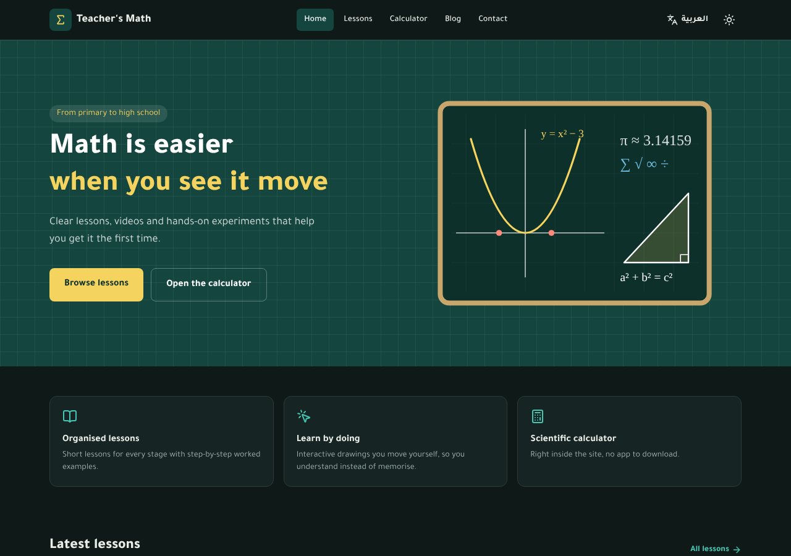
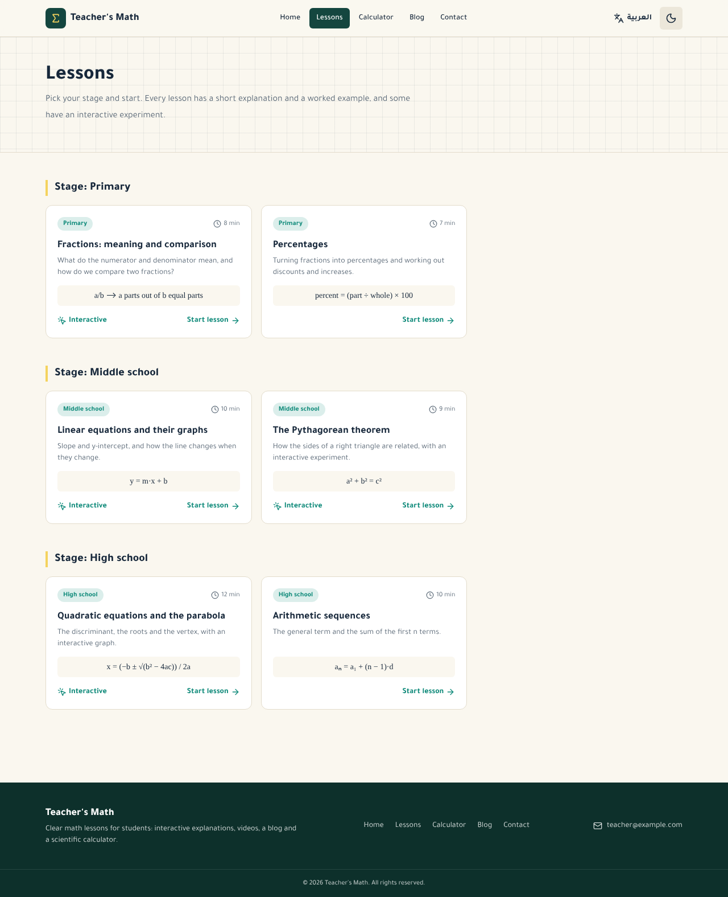

# Teacher's Math (رياضيات المعلم)

[العربية](README.md) · **English**

A math lessons website for students: lessons with interactive drawings, videos, a blog, a scientific calculator and a contact form. Available in Arabic and English, with light and dark modes.



## Contents

- [The idea](#the-idea)
- [The solution](#the-solution)
- [Features](#features)
- [Tech stack](#tech-stack)
- [Commands used to build the project](#commands-used-to-build-the-project)
- [Running it](#running-it)
- [Project structure](#project-structure)
- [Code organisation](#code-organisation)
- [Editing content](#editing-content)
- [Contact form](#contact-form)
- [Deploying to Apache](#deploying-to-apache)
- [Pushing to GitHub](#pushing-to-github)
- [Known limits](#known-limits)

## The idea

A math teacher wants one place online that his students can come back to outside class: the explanation of the lesson, a worked example, a video, and a tool to try the idea with their own hands.

**The problem**

- A lesson is explained once in class; a student who misses part of it has no organised reference to return to.
- The teacher's material is scattered across chat groups, video links and paper.
- Many math concepts (slope, the discriminant, comparing fractions) are understood faster by experimenting than by reading, and a textbook does not move.
- Students need a scientific calculator and a way to ask the teacher, without installing extra apps.

## The solution

A fast static website that brings all of this together:

| Need | What the site offers |
|---|---|
| An organised reference | A lessons page grouped by stage (primary, middle, high school); each lesson has a short explanation, a formula and a worked example |
| Learning by doing | Interactive drawings the student moves: fraction comparison, the Pythagorean theorem, a line, a parabola |
| Video | A YouTube slot in every lesson; the player loads only when clicked |
| Calculator | A scientific calculator inside the site, usable from the keyboard |
| Reaching the teacher | A contact form that delivers to the teacher's email |
| Extra content | A blog for tips and articles |
| Wider audience, comfortable reading | Arabic and English interfaces, light and dark modes |

The site is **static** by design: it runs on any Apache hosting without a Node server, it is fast, and it costs next to nothing to run.

## Features

- **6 lessons** in Arabic and English, four of them with an interactive drawing.
- **Scientific calculator**: trig functions (degrees/radians), roots, logarithms, powers, factorial, and a history of recent calculations. Expressions are parsed by a custom parser, with no `eval`.
- **Blog** with three posts.
- **Two languages**: `/ar/` and `/en/`, switching to the same page in the other language and flipping direction (RTL/LTR) automatically.
- **Dark/light mode** that follows the device setting on the first visit and then remembers the visitor's choice.
- **SEO**: Open Graph tags, `hreflang`, `sitemap.xml`, `robots.txt`.
- **Performance**: Priority Hints (hero image high priority, video thumbnails low priority), a self-hosted font, caching and compression from Apache.



## Tech stack

| Technology | Version | Role |
|---|---|---|
| [Next.js](https://nextjs.org) (App Router) | 16.4 | Framework and static site generation (SSG via `output: "export"`) |
| [React](https://react.dev) | 19 | UI and interactive components |
| [TypeScript](https://www.typescriptlang.org) | 5 | Types |
| [Tailwind CSS](https://tailwindcss.com) | 4 | Styling; both themes through CSS variables |
| [Turbopack](https://nextjs.org/docs/app/api-reference/turbopack) | with Next.js | Development and build |
| [Lucide](https://lucide.dev) | `lucide-react` | Icons |
| [Tajawal](https://fontsource.org/fonts/tajawal) | `@fontsource/tajawal` | Arabic and Latin font, self-hosted |
| ESLint + Prettier | 9 / 3 | Linting and consistent formatting |
| Node.js test runner | built in | Unit tests, no extra dependency |
| Apache HTTP Server | 2.4 | Hosting, with HTTP/2, compression and caching |
| Priority Hints | `fetchPriority` | Image loading priority |
| Open Graph | Metadata API | Social sharing cards |
| [Web3Forms](https://web3forms.com) or PHP | optional | Sending the contact form |

## Commands used to build the project

```bash
# 1) Create the project: TypeScript + Tailwind + App Router + Turbopack
npx create-next-app@latest riyadiyat-almoallem \
  --ts --tailwind --app --turbopack \
  --no-eslint --no-src-dir --import-alias "@/*" --use-npm

cd riyadiyat-almoallem

# 2) Icons and font
npm install lucide-react @fontsource/tajawal

# 3) Code quality tools
npm install -D prettier eslint eslint-config-next

# 4) Development
npm run dev

# 5) Checks and build (produces the static out/ folder)
npm run check
npm run build
```

After scaffolding, `next.config.ts` was changed to produce a static export:

```ts
const nextConfig: NextConfig = {
  output: "export",       // static site in out/
  trailingSlash: true,    // every page = folder/index.html, served directly by Apache
  images: { unoptimized: true },
  experimental: { globalNotFound: true }, // single 404 page
};
```

## Running it

Requires Node.js 20 or newer (`npm test` needs 22.6 or newer).

```bash
npm install
cp .env.example .env.local   # then edit the values
npm run dev                  # http://localhost:3000
```

| Command | What it does |
|---|---|
| `npm run dev` | Development server |
| `npm run build` | Builds the static site into `out/` |
| `npm run check` | Type-check + lint + tests in one go |
| `npm run typecheck` | TypeScript check |
| `npm run lint` | ESLint |
| `npm test` | Unit tests for the calculator and math logic |
| `npm run format` | Formats the code with Prettier |

Environment variables (`.env.local`):

| Variable | Purpose |
|---|---|
| `NEXT_PUBLIC_SITE_URL` | Final site URL, used in Open Graph and the sitemap |
| `NEXT_PUBLIC_WEB3FORMS_KEY` | Web3Forms key for the contact form (optional) |

## Project structure

```
app/
  [lang]/                   pages for each language (ar, en)
    layout.tsx              root layout: lang, dir, theme script
    page.tsx                home
    lessons/                lesson list + lesson page [slug]
    blog/                   post list + post page [slug]
    calculator/  contact/
  global-not-found.tsx      404 page
  globals.css               theme colours (design tokens) and font
  sitemap.ts, robots.ts
components/                 UI only, grouped by feature
  layout/                   Header, NavLinks, LanguageSwitch, ThemeToggle, useTheme, Footer, PageHeader
  ui/                       Card, Slider, MathText, BackLink, SectionHeader, DirectionalArrow
  home/                     Hero, Features
  lessons/                  LessonCard, StageBadge, Duration, VideoEmbed, LessonWidget
    widgets/                FunctionGrapher, CoordinatePlane, PythagorasExplorer,
                            FractionVisualizer, FractionPie, WidgetLayout
  calculator/               Calculator, Display, Keypad, AngleModeToggle, History,
                            useCalculator, useCalculatorKeyboard
  blog/                     PostCard, PostMeta
  contact/                  ContactForm
lib/                        logic and data, no UI
  i18n/                     config.ts (languages), ar.ts, en.ts (UI strings), index.ts
  calculator/               evaluate.ts (expression parser), keys.ts, evaluate.test.ts
  math/                     quadratic.ts, fractions.ts, format.ts, quadratic.test.ts
  lessons.ts, posts.ts      content (Arabic + English)
  localize.ts               merges shared fields with one language's text
  routes.ts                 every URL of the site + page params helpers
  meta.ts                   canonical + hreflang + Open Graph
  theme.ts, storage.ts      dark/light logic, safe localStorage
  contact.ts                contact form sending (Web3Forms or PHP)
  site.ts, classNames.ts
public/
  .htaccess                 Apache settings
  api/contact.php           contact form handler (PHP fallback)
  index.html                redirects / to the saved language
  hero.svg, og.png, og-en.png, icon.svg
deploy/apache-vhost.conf    example VirtualHost with HTTP/2
```

## Code organisation

The code follows a few simple rules:

- **Logic is separate from UI.** Everything in `lib/` is plain TypeScript with no React, so it can be tested on its own. Components only render and wire events.
- **One job per file.** The calculator, for example, is split into the parser (`evaluate.ts`), the key layout (`keys.ts`), state (`useCalculator`), keyboard handling (`useCalculatorKeyboard`) and small display components.
- **No repeated strings.** URLs come from `lib/routes.ts`, UI text from `lib/i18n/`, colours from the tokens in `globals.css`.
- **Named constants instead of magic numbers**, and comments that explain why, not what.

Run `npm run check` before every commit.

## Editing content

| What | Where |
|---|---|
| Lessons and YouTube video id (`videoId`) | `lib/lessons.ts` |
| Blog posts | `lib/posts.ts` |
| Site name and UI strings | `lib/i18n/ar.ts` and `lib/i18n/en.ts` |
| Email and site URL | `lib/site.ts` |
| Theme colours | `app/globals.css` |
| Share images | `public/og.png` and `public/og-en.png` |

Every lesson and post is written in both `ar` and `en`. After any change: `npm run build`, then upload `out/` again.

## Contact form

Two methods; the form picks one automatically:

1. **Web3Forms** (when `NEXT_PUBLIC_WEB3FORMS_KEY` is set): sends straight from the browser, so it works locally and on any hosting. Get the key from [web3forms.com](https://web3forms.com) using the teacher's email.
2. **PHP** (when the key is empty): uses `public/api/contact.php` and needs hosting with PHP and `mail()`. Edit `TO_EMAIL` and `FROM_EMAIL` at the top of the file.

## Deploying to Apache

1. Put the real site URL in `NEXT_PUBLIC_SITE_URL` inside `.env.local`.
2. Run `npm run build`.
3. Upload the **contents** of `out/` to the `DocumentRoot`, including the hidden `.htaccess` file.
4. Enable HTTP/2 in the server config following `deploy/apache-vhost.conf`: the line `Protocols h2 http/1.1`, with a TLS certificate and `mpm_event`.

Required Apache modules:

```bash
sudo a2enmod http2 ssl headers rewrite deflate
sudo systemctl restart apache2
```

## Pushing to GitHub

The project already contains a local Git repository (created by `create-next-app`), and `.gitignore` excludes `node_modules`, `.next`, `out` and `.env` files.

**1) Create an empty repository on GitHub** at [github.com/new](https://github.com/new) named `riyadiyat-almoallem`, without a README or `.gitignore`.

**2) Commit locally:**

```bash
cd riyadiyat-almoallem
git add .
git commit -m "Teacher's Math: first release"
git branch -M main
```

**3) Add the remote and push** (replace `USERNAME` with your account name):

```bash
git remote add origin https://github.com/USERNAME/riyadiyat-almoallem.git
git push -u origin main
```

**One-command alternative** if the [GitHub CLI](https://cli.github.com) is installed:

```bash
gh auth login
gh repo create riyadiyat-almoallem --public --source=. --remote=origin --push
```

Use `--private` instead of `--public` for a private repository.

**4) Later updates:**

```bash
git add .
git commit -m "describe the change"
git push
```

**Before pushing, check that:**

- `.env.local` is not included (`git status` must not list it).
- The email in `lib/site.ts` and `public/api/contact.php` is one you accept being public, if the repository is public.
- The `out/` folder is not pushed to GitHub; it is built at deploy time.

## Known limits

- Adding a lesson or post means editing code and rebuilding; there is no dashboard.
- Videos are not added yet: each lesson shows "Video coming soon" until a `videoId` is set.
- The current lesson and post texts are a starting draft and need the teacher's review.
- The English name "Teacher's Math" is a suggested translation.
